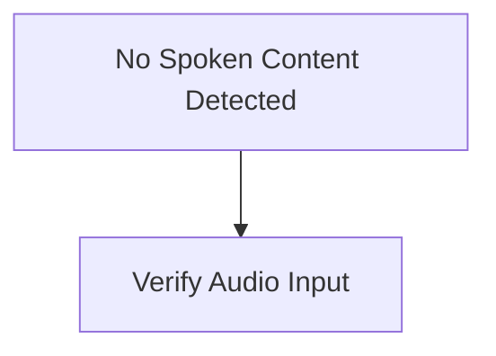

# Audio
⚠️ *Transcription failed*
# Audio
**Speaker 1**:
## Summary
### Overview
- No audio content or speech was detected in the transcript.
## Insights
### Analysis
Without recorded speech content, no specific insights or context maps can be derived.

### Recommendations
- Verify microphone connection and input volume before recording.
- Ensure audio transcription software captures input correctly.
## Mermaid Chart
