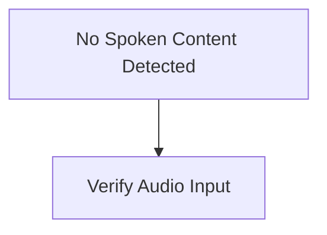
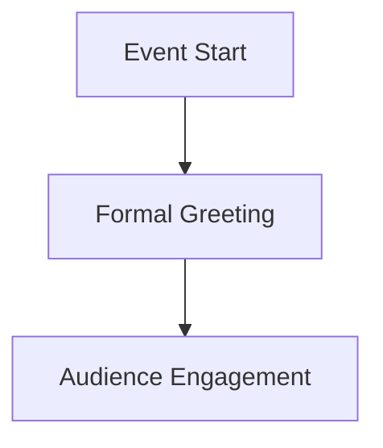

# Audio
⚠️ *Transcription failed*
# Audio
**Speaker 1**:
## Summary
### Overview
- No audio content or speech was detected in the transcript.
## Insights
### Analysis
Without recorded speech content, no specific insights or context maps can be derived.

### Recommendations
- Verify microphone connection and input volume before recording.
- Ensure audio transcription software captures input correctly.
## Mermaid Chart

Recording 20261108121937.m4a
# Audio
Secure vault/Agenda08-11-2026 .880.webm
**Speaker 1**: Good evening, ladies and gentlemen.
## Summary
### Opening Remarks
- Delivered a formal evening greeting to the audience.
## Insights
### Context & Structure
- Brief introductory greetings typically mark the start of a session or presentation. While minimal on direct information, they establish context and tone.

### Recommendations
- Pair introductory remarks with the primary agenda or follow-up discussion points as further recording becomes available.
## Mermaid Chart
