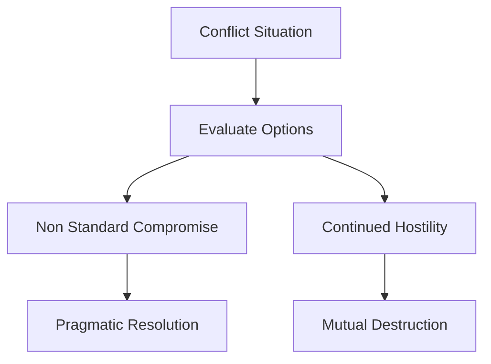

# Audio
How about, how about we have a compromise? A non-standard solution for a non-standard situation? How about that? Or maybe you want to keep fighting me until one of us is dead? How about that? Is that what you want? Is that what you really want?
## Summary
### Options for Resolution   - **Compromise:** Implement a non-standard solution tailored for a non-standard situation.   - **Continued Escalation:** Persist in conflict until complete destruction.   - **Reflection:** Assess whether high-stakes conflict is genuinely the desired outcome.
## Insights
### Strategic Negotiation   When faced with intense deadlock, presenting a stark binary between pragmatic compromise and total destruction forces a re-evaluation of goals.   ### Actionable Enhancements   - Develop creative out-of-the-box compromises for unique challenges.   - Explicitly define the costs of refusal to encourage settlement.
## Mermaid Chart
