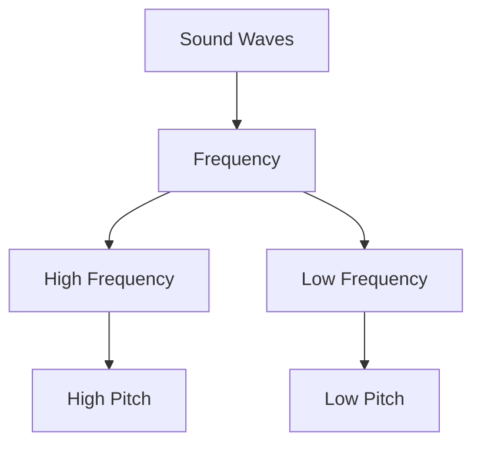

# Audio
Secure vault/Agenda08-11-2026 .webm
⚠️ *Transcription failed*

# Audio
Secure vault/Agenda08-11-2026 .webm
**Speaker 1**: I can see something. The pitch of a sound is related to its frequency. High frequency sound waves have a high pitch, and low frequency sound waves have a low pitch. High frequency sound waves have a high pitch, and low frequency...
## Summary
### Core Concepts
- Sound pitch is directly determined by wave frequency.
- **High Frequency**: Produces high-pitched sounds.
- **Low Frequency**: Produces low-pitched sounds.
## Insights
### Audio Physics Connections
Understanding pitch as a physical frequency property is fundamental for psychoacoustics, music theory, and sound design.

### Suggested Enhancements
- **Amplitude Relation**: Explore how wave amplitude impacts volume independently of pitch.
- **Auditory Spectrum**: Map specific frequency ranges in Hertz to human pitch perception limits.
## Mermaid Chart
